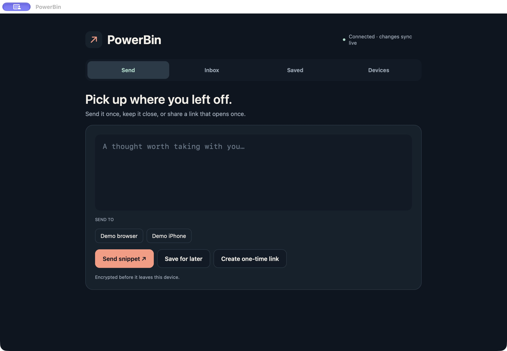

# PowerBin

A self-hosted text relay built with Native Shell, PowerSync, and Postgres. Send
text to one paired device, save snippets across your own devices, or create a
one-use link for someone else. Files and images are out of scope.

Start with the two PowerSync integrations:
[native Rust SDK](app/src/db_native.rs) and [browser Web SDK](app/web/src/adapter.ts).
The [UI](app/App.tsx) uses Native Shell TSX and native components. The
[controller](app/src/controller.rs) and [cryptography](crypto/) remain Rust,
compiled natively or to WebAssembly. A generated, typed
[bridge](app/src/bridge.rs) pushes display state into TSX signals and sends
commands back to the Rust core.

## Run locally

Prerequisites: Node.js 22.12+, pnpm 12.18.0 installed with its standalone installer
or Homebrew, Docker with Compose 2.20.3+, Rust stable (validated
with 1.99.1), and the Native Shell 0.4 CLI. macOS builds need Xcode command-line
tools. Browser packaging also needs the `wasm32-unknown-unknown` Rust target
and `wasm-bindgen-cli` exactly 0.2.129, plus LLVM `clang` with WebAssembly support
and `llvm-ar` for the mixed runtime's native dependencies. See the
[browser toolchain example](app/README.md#browser-build).

From the repository root:

```sh
pnpm install --frozen-lockfile
pnpm run setup
pnpm run ps docker start
pnpm run migrate
pnpm run ps validate
pnpm run server
```

`setup` creates unique local credentials in `.env` and the Docker environment;
it preserves an existing `.env`. Keep these files private. Read the bootstrap
token locally when needed; do not log, commit, or paste the environment contents.

Defaults are API `http://localhost:18088`, PowerSync `http://localhost:18080`,
web `http://localhost:4173`, source Postgres `15432`, and PowerSync's separate
storage Postgres `15433`. This is an isolated local Docker stack.

In another terminal, package and launch the macOS app:

```sh
nsh package app --target macos --out .nsh/out/macos --run
```

On the first device, enter `BOOTSTRAP_TOKEN` from your local `.env` in the setup
screen. On another device, choose pairing and enter its short rendezvous code
on the existing device. Compare the **entire fingerprint on both screens**
before approving. The short code is not a secret or a substitute for verification.

## Browser app

Build the small PowerSync adapter before packaging the mixed TSX/Rust app:

```sh
pnpm run web:build
```

`web:build` builds the adapter, packages the TSX views and Rust/WASM core, and copies the entire
adapter output, including workers and SQLite WASM assets, into the site.
Restart the backend with the packaged site, then open `http://localhost:18088`:

```sh
WEB_DIST="$PWD/.nsh/out/PowerBin" pnpm run server
```

This serves the app, guest links, and API from one origin. For links created in
the native app to point here, set `WEB_ORIGIN` to `http://localhost:18088` in
`.env` and rebuild the native app. App builds embed only the public API/web URLs.

## Code map

| File | Responsibility |
| --- | --- |
| [app/src/db_native.rs](app/src/db_native.rs) | Rust SDK connection, local queries, watches, upload queue |
| [app/web/src/adapter.ts](app/web/src/adapter.ts) | Web SDK equivalent and browser worker setup |
| [app/src/controller.rs](app/src/controller.rs) | Pairing, encrypted sends, saves, and burn actions |
| [app/App.tsx](app/App.tsx), [app/ui/](app/ui/) | Shared Native Shell TSX screens and components |
| [app/src/bridge.rs](app/src/bridge.rs) | Typed Rust state/action subscription; session secrets stay in Rust |
| [powersync/sync-config.yaml](powersync/sync-config.yaml) | Sync Streams scoped to an authenticated device |
| [crypto/](crypto/) | Noise pairing/transfers, saved-snippet encryption, directory authentication |
| [server/src/server.js](server/src/server.js) | Authentication, opaque writes, pairing, and atomic consumption |

Writes enter local SQLite, the SDK uploads them to the backend, and PowerSync
replicates Postgres changes back to local queries. The server sees metadata and
encrypted payloads. The app keeps the SDK integration explicit, without a
generic repository or state-management framework. See [app/README.md](app/README.md).

## Privacy and burning

Native device secrets live in the OS credential store; remembered browser
secrets live in IndexedDB for that origin. Losing all device keys loses access
to saved snippets. There is no recovery flow.

Directed transfers and guest links expire after one hour. Guest mode opens no
local PowerSync database. Opening a link checks availability; **Reveal & burn**
atomically claims its ciphertext once. An ambiguous network failure after that
claim can lose the message; it cannot be revealed again.

Copy & burn hides a transfer locally and queues its server burn. When uploaded,
the burn clears the server payload and propagates that change through sync.
It cannot retract clipboard contents, screenshots, previously copied text, or
offline copies, and it is not forensic deletion of SQLite journals or backups.
The application protocol is unaudited; this is a demo, not a security-reviewed
secret-sharing service. Browser clients also trust the JavaScript/WASM served
by their origin.

## Verification

```sh
pnpm test
pnpm run test:integration
cargo test --manifest-path crypto/Cargo.toml
cargo run --manifest-path app/Cargo.toml --example sync_smoke
pnpm --dir app/web run check
pnpm --dir app/web run build
nsh check app
nsh test app/bridge.test.tsx
nsh build app
```

The integration tests need the local Postgres stack. The native smoke test also
needs the API and PowerSync running; it uses two real SDK clients and temporary
devices/databases, with cleanup on normal exit.

The following records the Rust-view implementation's **pre-migration baseline**.
Compilation or packaging of the TSX migration does not by itself reverify these
runtime flows. Migration validation is recorded separately in
[docs/tsx-migration-validation.md](docs/tsx-migration-validation.md).

| Checked before migration | Result |
| --- | --- |
| Backend/domain, web-serving, and signing-key tests | 17 passing |
| Actual Postgres integration tests | 9 passing |
| Shared crypto tests | 11 passing |
| Two-client native PowerSync smoke | Passed, including disconnected insert, SQLite reopen, and queued upload after reconnect |
| Docker images | Built; isolated four-service smoke passed, including signing-key persistence across container replacement |
| macOS | Packaged, launched, and visually checked |
| Linux | App/SDK compilation passed; runtime not checked |
| iOS | iOS 27.2 simulator: paired with macOS, transfers both ways, clipboard/burn, saved decryption, and identity/key restoration after restart verified |
| Browser | Paired with macOS; both transfer directions, clipboard/burn, saved snippets, and one-use guest links verified |
| Android | ARM64 APK built, installed, and launched on API 35 emulator with no startup errors; UI flows not checked |

Android's public embedding host and prerequisites are in
[app/android/README.md](app/android/README.md). The four-service Railway setup is in
[railway/README.md](railway/README.md). No Railway template or deployment has been published.

## Demo material

The [blog draft](docs/blog-draft.md) explains the integration and its privacy
boundaries. The [28-second social-video draft](docs/media/powerbin-social-draft.mp4)
uses real app captures with cuts between states; edited timings are not a latency
benchmark. The [shot list](docs/social-video.md) provides a recording outline.


