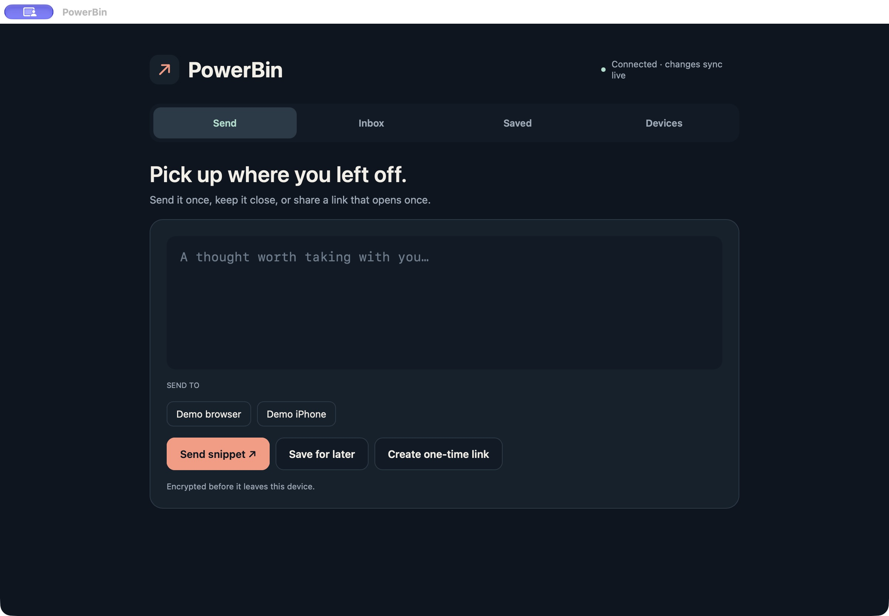

# PowerBin: a private text relay with Native Shell and PowerSync

Copying something from a laptop to a phone should be a small interaction. PowerBin
turns it into one: choose a device, send some text, then copy it at the other end.
Copy & burn hides the snippet locally and queues its server burn. For text you
want to keep, there is a separate Saved tab.



PowerBin is a self-hosted demo of [Native Shell](https://nsh.dev/) and PowerSync. Its
UI uses Native Shell TSX; the controller and encryption code remain Rust.
Native builds use the PowerSync Rust SDK; the browser compiles the Rust core
to WebAssembly and connects through a small PowerSync Web SDK adapter.
Postgres is the shared source of truth.

## Start with the integration

The useful place to begin reading is
[`app/src/db_native.rs`](../app/src/db_native.rs). It opens a local SQLite
database, supplies the schema, and connects PowerSync to an authenticator and
mutation uploader. There is no application-specific replication protocol.

Sending a snippet encrypts its text and executes an ordinary local insert:

```sql
INSERT INTO items
  (id, kind, sender_id, recipient_id, payload, created_at, expires_at)
VALUES (?, ?, ?, ?, ?, ?, ?)
```

PowerSync queues that change. The uploader forwards it to the backend, which
checks the authenticated device's permission and writes to Postgres. PowerSync
then replicates the row to the devices selected by the
[Sync Streams](../powersync/sync-config.yaml). A watched local query updates the
receiving UI, and the receiving device decrypts the payload.

The browser follows the same path. Its
[`adapter.ts`](../app/web/src/adapter.ts) contains the schema, credential fetch,
upload handler, SQL operations, and query watches. The Rust controller calls
those operations through a small WASM bridge. Keeping these two integrations
explicit makes it possible to read each SDK's role without tracing a generic
data-access framework.

Saved snippets are persisted locally, so an enrolled device can read its saved
text without waiting for a network response. Local writes can queue while
disconnected. Delivery to another device still requires connectivity. A queued
transfer that first reaches the backend after expiry is stored as an empty
burned tombstone rather than delivered late.

## Native components from one app

The [shared TSX UI](../app/App.tsx) uses Native Shell components for navigation,
text fields, buttons, cards, and layout. Native TSX executes through QuickJS;
the browser uses its own JavaScript engine. The Rust controller stays the same
across native and browser builds. A generated, typed
[bridge](../app/src/bridge.rs) pushes display snapshots into TSX signals and
accepts actions without exposing session secrets. Platform-specific code
supplies the database SDK, clipboard, and secret storage.

That makes the cross-platform story visible in both the demo and its source:
send from the browser, receive in a native window, and watch a saved snippet
appear in both. The repository records the distinction between successful
compilation, packaging, and runtime checks for each target.

## Privacy has its own responsibilities

PowerSync transports encrypted payloads; the application handles encryption and
trust. A new remembered device pairs with an existing one through a Noise
handshake. Both screens show the full fingerprint for comparison before approval.
The approved device receives the key needed to decrypt saved snippets. Device
secrets stay in the platform credential store, or in origin-local IndexedDB in
the browser.

A directed transfer is encrypted for one recipient. When the queued burn reaches
the backend, it clears the server payload and PowerSync replicates that state.
Transfers expire after one hour; the app blocks expired reads and the backend
periodically clears expired payloads. Burning cannot retract a clipboard, a screenshot, or a copy already
held by an offline device, and it does not promise forensic erasure of journals
or backups.

For a person who has not paired a device, PowerBin can create a one-use link. The
decryption key lives in the URL fragment. Opening the link checks availability;
an explicit Reveal & burn request atomically claims the ciphertext. Guest mode
does not open a PowerSync database. If the response is lost after the claim, the
message is lost too: the server will not reveal it a second time.

The protocol is a demo and has not had a security audit. Losing every device's
keys loses access to saved text. A browser client also trusts the code delivered
by its origin. These boundaries are part of the application, not guarantees
provided by the sync engine.

## Run it yourself

The [repository README](../README.md) starts an isolated local stack with two
Postgres databases, PowerSync, and PowerBin's API. The same API can serve the
packaged browser app. The [Railway setup](../railway/README.md) supplies Docker
images and service settings for self-hosting; template publication is a separate
step.

For the shortest code tour, read the native database integration, the browser
adapter, and the Sync Streams configuration. Those files show the central loop:
write local SQL, upload through your backend, and react to local queries as
PowerSync brings changes home.
